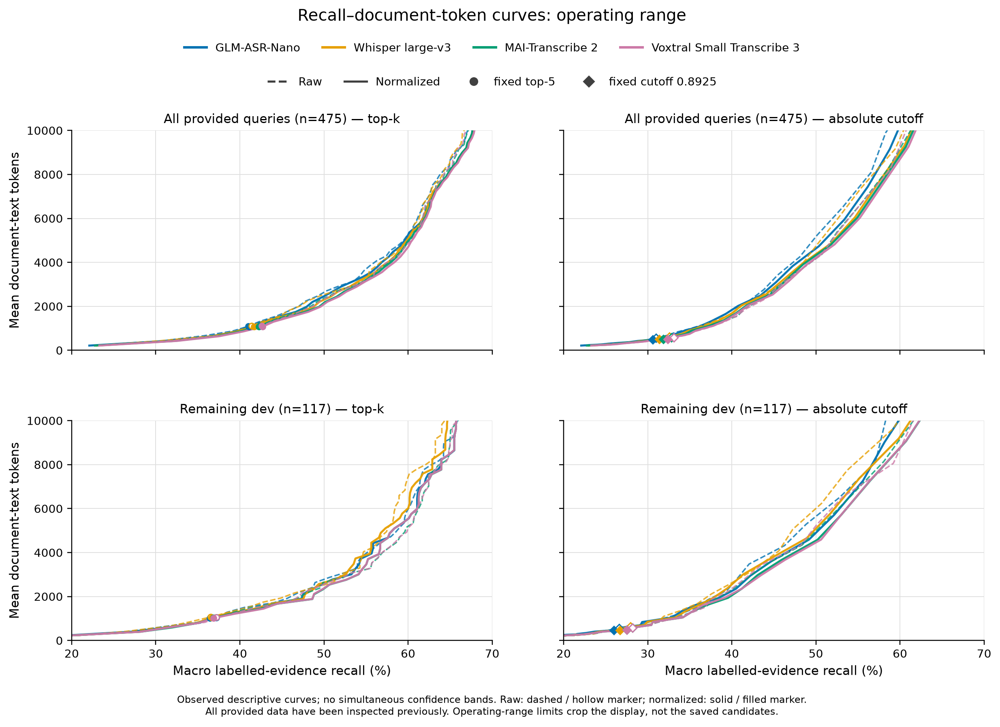
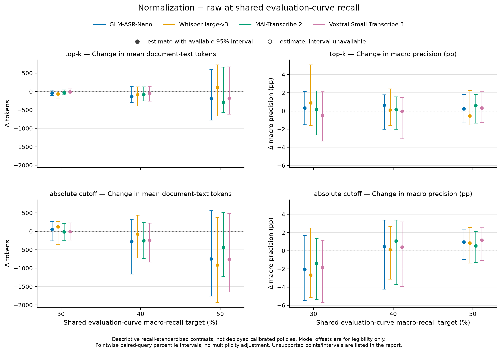

# ASR recall–token curves, calibration transfer and paired intervals

This follow-up reuses the saved four-model raw/normalized transcriptions and query vectors. It makes **zero new ASR, encoder or external API calls**. The fixed normalization rule and the original 0.8925 control are retained.

## Main descriptive findings

- **These comparisons do not establish a stable normalization benefit at shared recall.** For all 24 descriptive normalization contrasts (four models × two policy families × three targets), the token-cost, macro-precision and micro-precision pointwise 95% intervals each include zero. This is insufficient evidence for a stable benefit; it does not establish equivalence or prove zero effect.
- At **40% descriptive evaluation-curve recall**, cutoff minus top-k mean document-token cost is **+772.1 to +1223.6 tokens** across the eight model/input settings. All eight pointwise 95% cost intervals lie above zero. These are exploratory, unadjusted pointwise comparisons, not a simultaneous or universal policy claim. Macro-precision point differences are **+5.02 to +7.67 pp**, while micro-precision point differences are **-5.14 to -3.49 pp**. The two precision definitions therefore do not support an unqualified precision-improvement statement.
- **A 40% practice calibration target does not produce 40% evaluation recall.** The observed remaining-dev recalls range from **32.369% to 36.897%**. This transfer result must remain separate from descriptive exact-recall standardization; the intervals quantify its sampling and calibration variability.

## Two distinct estimands

1. **Calibration transfer:** choose threshold/top-k mixture parameters using **350 practice queries**, then apply those exact indices and mixture weights to the **117 remaining dev queries**, excluding the eight pilot queries. A common calibration target does **not** guarantee equal achieved evaluation recall. Evaluation recall is reported explicitly; this is the transfer result for a deployable, calibration-chosen rule.
2. **Descriptive evaluation-curve standardization:** evaluate the predeclared curve functional at a common recall target on the same remaining-dev evaluation queries. Its interpolation uses evaluation labels as part of a descriptive metric. It is **not** an independently selected deployment threshold, and it must not replace the frozen calibration-transfer result.

Both analyses are exploratory: all 475 recordings' fixed-policy summaries have already been inspected; the normalization rule was designed after the original eight-query pilot and the old cutoff used public dev labels. The new calibration/evaluation query sets are disjoint for this calibration step, not a newly untouched holdout.

## Metric and mixture definitions

- Macro recall averages each original query's retrieved positive-qrel fraction. Macro precision averages each query's hits/returned-documents ratio.
- Mean document-text tokens exclude question/system text, labels, separators and chat framing. They are not billed prompt tokens or an end-to-end cost measure.
- A two-policy mixture uses **one query-independent probability** for every query. Expected recall, macro precision, hits, documents and token cost are mixed analytically. Micro precision is **mixed expected hits divided by mixed expected documents**, not a linear interpolation of the two micro-precision ratios.
- Interpolation is between adjacent distinct-recall candidate points. Recall plateaus select lowest mean tokens, then mean documents, numeric parameter and original index, with absolute recall tolerance 1e-12. This is not a globally optimized convex-envelope policy. Targets outside observed support are unsupported; no extrapolation is performed.
- Intervals use **5000 query-level bootstrap replicates**. Calibration and evaluation are resampled separately; within each set the same indices are shared by every model, input condition and policy. For calibration-transfer intervals, parameter selection is repeated within each replicate. Fixed 0.8925/top-5 controls are not tuned. Intervals are pointwise percentile intervals, unadjusted for multiple comparisons.
- Matched-curve bootstrap replicates recompute curve means and interpolation. A panel/target uses a common complete support mask across all settings. Support counts and unavailable intervals are disclosed below; they are not silently counted as zero.

## Execution metadata

| Field | Value |
| --- | --- |
| calibration_queries | `350` |
| evaluation_queries | `117` |
| bootstrap_replicates | `5000` |
| seed | `20261117` |
| slurm_job_id | `3726791` |
| git_head | `ea722901efadaa008eb37b2f52491f50cf2f09f1` |
| numpy_version | `2.4.6` |
| scipy_version | `1.17.1` |
| rendering_slurm_job_id | `3726810` |

Independent saved-data audit **3726799** passed. It checked **112 operating points**, **196 paired contrasts**, **1540 point/contrast intervals** and **14736 saved curve rows**. It independently reconstructed **25 saved bootstrap replicates**; this is distinct from recomputing the reported percentile bounds from every saved distribution.

### Retained runtime warning

The saved runtime metadata retains a generic SciPy warning mentioning BCa. The run was configured with **method=percentile**; unsupported NaNs remain in the raw bootstrap distribution. The intervals reported here are explicit **2.5th/97.5th percentile quantiles over the disclosed finite common-support mask**, rather than the raw SciPy interval summary. **No BCa interval is used.** The independent saved-data audit confirmed these finite-mask percentile values.

## Observed recall–token curves

The operating-range plot shows macro recall 20–70% and mean document-text tokens 0–10,000. Axis limits crop the display only; the full candidate-range plot is provided separately. The all-475 panels are descriptive. The remaining-dev panels show the evaluation cohort. Neither line plot is a simultaneous confidence band.

[Operating-range PDF](figures/asr-recall-token-operating.pdf) · [Full-range PNG](figures/asr-recall-token-full.png) · [Full-range PDF](figures/asr-recall-token-full.pdf)

## Fixed controls on the evaluation cohort

The original top-5 and absolute cutoff 0.8925 are retained without retuning. Tables show the point estimate followed by its query-level 95% interval. 'CI unavailable' does not mean a zero-width interval.

| ASR | Input | Policy | Evaluation recall (%) [95% CI] | Macro precision (%) [95% CI] | Micro precision (%) [95% CI] | Mean tokens [95% CI] |
| --- | --- | --- | --- | --- | --- | --- |
| GLM-ASR-Nano | raw | top-k | 37.226 [30.155, 44.595] | 16.068 [12.991, 19.316] | 16.068 [12.991, 19.316] | 1035.7 [959.2, 1121.9] |
| GLM-ASR-Nano | normalized | top-k | 36.442 [29.499, 43.804] | 15.897 [12.821, 19.145] | 15.897 [12.821, 19.145] | 1022.2 [947.7, 1103.5] |
| Whisper large-v3 | raw | top-k | 36.513 [29.576, 43.899] | 15.726 [12.650, 18.974] | 15.726 [12.650, 18.974] | 1068.8 [987.7, 1160.2] |
| Whisper large-v3 | normalized | top-k | 36.656 [29.606, 44.162] | 16.068 [12.821, 19.316] | 16.068 [12.821, 19.316] | 1032.2 [955.0, 1117.6] |
| MAI-Transcribe 2 | raw | top-k | 37.226 [30.155, 44.595] | 16.068 [12.991, 19.316] | 16.068 [12.991, 19.316] | 1051.5 [971.4, 1141.3] |
| MAI-Transcribe 2 | normalized | top-k | 36.869 [29.866, 44.358] | 16.068 [12.991, 19.316] | 16.068 [12.991, 19.316] | 1027.8 [952.8, 1110.3] |
| Voxtral Small Transcribe 3 | raw | top-k | 37.226 [30.155, 44.595] | 16.068 [12.991, 19.316] | 16.068 [12.991, 19.316] | 1048.4 [968.5, 1137.9] |
| Voxtral Small Transcribe 3 | normalized | top-k | 36.869 [29.866, 44.358] | 16.068 [12.991, 19.316] | 16.068 [12.991, 19.316] | 1019.9 [945.1, 1102.4] |
| GLM-ASR-Nano | raw | absolute cutoff | 26.606 [20.226, 33.646] | 33.973 [26.336, 42.108] | 26.182 [18.211, 35.318] | 559.0 [391.3, 767.5] |
| GLM-ASR-Nano | normalized | absolute cutoff | 25.965 [19.831, 32.631] | 34.102 [26.354, 42.113] | 30.769 [23.162, 38.865] | 469.3 [348.1, 617.6] |
| Whisper large-v3 | raw | absolute cutoff | 27.960 [21.376, 35.176] | 32.680 [24.897, 40.593] | 24.026 [16.986, 32.433] | 625.2 [438.0, 841.9] |
| Whisper large-v3 | normalized | absolute cutoff | 26.677 [20.305, 33.705] | 34.093 [26.163, 42.260] | 30.380 [22.939, 38.318] | 472.3 [349.6, 624.2] |
| MAI-Transcribe 2 | raw | absolute cutoff | 28.173 [21.687, 35.248] | 34.755 [26.938, 42.754] | 27.076 [18.966, 36.264] | 570.3 [400.1, 778.7] |
| MAI-Transcribe 2 | normalized | absolute cutoff | 27.532 [21.167, 34.544] | 34.971 [27.070, 42.942] | 31.513 [23.904, 39.450] | 474.6 [352.2, 624.8] |
| Voxtral Small Transcribe 3 | raw | absolute cutoff | 28.173 [21.687, 35.248] | 34.798 [27.027, 42.782] | 27.076 [19.000, 36.264] | 568.9 [398.9, 778.4] |
| Voxtral Small Transcribe 3 | normalized | absolute cutoff | 27.532 [21.167, 34.544] | 34.971 [27.070, 42.942] | 31.381 [23.825, 39.352] | 474.7 [352.4, 625.0] |

## Calibration transfer: frozen practice-selected parameters

The same calibration recall target is used for every arm, but the evaluation recalls below may differ. Cost/precision differences at unequal achieved evaluation recall are **not** automatically matched-recall efficiency claims.

### Calibration target: 30.0%

| ASR | Input | Policy | Calibration recall (%) | Evaluation recall (%) [95% CI] | Macro precision (%) [95% CI] | Micro precision (%) [95% CI] | Mean tokens [95% CI] |
| --- | --- | --- | --- | --- | --- | --- | --- |
| GLM-ASR-Nano | raw | top-k | 30.000 | 25.342 [18.710, 33.033] | 27.789 [20.699, 35.713] | 26.840 [20.358, 34.074] | 368.1 [286.1, 506.2] |
| GLM-ASR-Nano | normalized | top-k | 30.000 | 25.106 [18.360, 32.740] | 28.328 [21.262, 36.075] | 27.361 [20.849, 34.492] | 356.6 [282.1, 460.3] |
| Whisper large-v3 | raw | top-k | 30.000 | 25.043 [18.396, 32.812] | 27.662 [20.310, 36.464] | 26.421 [19.945, 34.281] | 367.0 [274.0, 494.6] |
| Whisper large-v3 | normalized | top-k | 30.000 | 25.424 [18.482, 33.300] | 29.087 [21.873, 36.921] | 28.023 [21.478, 35.458] | 342.8 [264.7, 448.2] |
| MAI-Transcribe 2 | raw | top-k | 30.000 | 25.271 [18.490, 33.207] | 30.256 [22.645, 38.573] | 28.798 [21.988, 36.648] | 340.9 [261.2, 444.4] |
| MAI-Transcribe 2 | normalized | top-k | 30.000 | 25.273 [18.410, 33.023] | 29.670 [22.555, 37.288] | 28.576 [22.027, 35.908] | 338.1 [265.0, 431.3] |
| Voxtral Small Transcribe 3 | raw | top-k | 30.000 | 25.418 [18.634, 33.321] | 30.049 [22.391, 38.633] | 28.645 [21.895, 36.753] | 339.0 [258.1, 446.6] |
| Voxtral Small Transcribe 3 | normalized | top-k | 30.000 | 24.803 [17.901, 32.595] | 30.116 [22.897, 38.130] | 28.910 [22.349, 36.586] | 327.8 [253.0, 417.6] |
| GLM-ASR-Nano | raw | absolute cutoff | 30.000 | 23.968 [17.277, 32.948] | 33.800 [25.825, 42.163] | 30.353 [18.835, 41.737] | 396.4 [242.1, 844.2] |
| GLM-ASR-Nano | normalized | absolute cutoff | 30.000 | 23.503 [16.982, 31.754] | 32.981 [24.995, 41.350] | 31.387 [21.624, 40.644] | 392.5 [255.0, 715.9] |
| Whisper large-v3 | raw | absolute cutoff | 30.000 | 23.974 [17.444, 32.400] | 33.448 [25.668, 42.241] | 33.022 [20.401, 43.009] | 333.2 [230.7, 694.3] |
| Whisper large-v3 | normalized | absolute cutoff | 30.000 | 23.694 [17.129, 31.575] | 33.668 [25.370, 42.009] | 32.899 [23.073, 42.282] | 357.8 [237.0, 610.8] |
| MAI-Transcribe 2 | raw | absolute cutoff | 30.000 | 23.353 [16.866, 31.772] | 34.822 [26.807, 43.473] | 35.537 [22.812, 44.360] | 306.7 [222.4, 605.5] |
| MAI-Transcribe 2 | normalized | absolute cutoff | 30.000 | 23.433 [16.928, 31.784] | 34.180 [26.060, 42.323] | 34.498 [24.419, 42.799] | 330.4 [232.6, 581.1] |
| Voxtral Small Transcribe 3 | raw | absolute cutoff | 30.000 | 22.969 [16.795, 31.254] | 34.986 [26.886, 43.434] | 36.441 [23.490, 44.392] | 293.7 [221.4, 564.8] |
| Voxtral Small Transcribe 3 | normalized | absolute cutoff | 30.000 | 23.013 [16.589, 31.116] | 33.952 [25.937, 42.376] | 34.865 [25.055, 43.236] | 311.8 [225.5, 543.5] |

### Calibration target: 40.0%

| ASR | Input | Policy | Calibration recall (%) | Evaluation recall (%) [95% CI] | Macro precision (%) [95% CI] | Micro precision (%) [95% CI] | Mean tokens [95% CI] |
| --- | --- | --- | --- | --- | --- | --- | --- |
| GLM-ASR-Nano | raw | top-k | 40.000 | 34.648 [26.199, 43.565] | 18.675 [12.719, 24.875] | 18.605 [12.681, 24.675] | 809.6 [574.7, 1402.7] |
| GLM-ASR-Nano | normalized | top-k | 40.000 | 34.158 [25.484, 43.600] | 19.508 [13.015, 26.013] | 19.329 [12.982, 25.822] | 747.3 [506.6, 1346.9] |
| Whisper large-v3 | raw | top-k | 40.000 | 32.837 [25.139, 42.565] | 19.879 [13.096, 25.978] | 19.615 [13.055, 25.752] | 749.2 [544.0, 1375.4] |
| Whisper large-v3 | normalized | top-k | 40.000 | 33.634 [25.546, 42.641] | 19.579 [13.457, 25.980] | 19.370 [13.419, 25.755] | 727.2 [498.9, 1236.4] |
| MAI-Transcribe 2 | raw | top-k | 40.000 | 33.035 [25.383, 41.985] | 21.060 [14.382, 27.139] | 20.822 [14.328, 26.856] | 700.1 [502.8, 1192.6] |
| MAI-Transcribe 2 | normalized | top-k | 40.000 | 33.342 [25.506, 42.236] | 20.337 [14.086, 26.964] | 20.081 [14.030, 26.648] | 684.0 [474.9, 1147.7] |
| Voxtral Small Transcribe 3 | raw | top-k | 40.000 | 33.054 [25.418, 42.135] | 21.646 [14.736, 27.433] | 21.451 [14.647, 27.130] | 684.2 [495.4, 1149.8] |
| Voxtral Small Transcribe 3 | normalized | top-k | 40.000 | 32.369 [24.929, 41.579] | 20.850 [14.562, 27.338] | 20.663 [14.509, 26.895] | 640.7 [456.6, 1069.0] |
| GLM-ASR-Nano | raw | absolute cutoff | 40.000 | 36.897 [28.380, 45.349] | 23.676 [15.743, 33.148] | 12.148 [7.529, 21.035] | 1780.6 [862.1, 3094.1] |
| GLM-ASR-Nano | normalized | absolute cutoff | 40.000 | 36.159 [27.514, 45.598] | 23.789 [15.922, 32.407] | 12.404 [8.013, 21.134] | 1668.6 [803.5, 2741.2] |
| Whisper large-v3 | raw | absolute cutoff | 40.000 | 34.988 [26.710, 44.079] | 25.839 [16.947, 34.248] | 12.622 [7.698, 21.790] | 1532.7 [728.6, 2876.0] |
| Whisper large-v3 | normalized | absolute cutoff | 40.000 | 35.121 [26.777, 44.031] | 25.534 [17.170, 33.658] | 13.488 [8.285, 22.908] | 1438.8 [707.2, 2550.9] |
| MAI-Transcribe 2 | raw | absolute cutoff | 40.000 | 35.614 [27.048, 44.295] | 28.361 [19.188, 36.564] | 14.889 [9.020, 24.963] | 1344.8 [654.0, 2487.6] |
| MAI-Transcribe 2 | normalized | absolute cutoff | 40.000 | 35.306 [27.255, 45.430] | 26.665 [17.939, 34.671] | 14.643 [8.697, 24.480] | 1318.8 [664.0, 2501.8] |
| Voxtral Small Transcribe 3 | raw | absolute cutoff | 40.000 | 35.176 [26.579, 43.695] | 28.962 [19.655, 37.194] | 15.501 [9.087, 26.481] | 1256.2 [597.1, 2391.5] |
| Voxtral Small Transcribe 3 | normalized | absolute cutoff | 40.000 | 35.064 [26.238, 44.660] | 27.035 [18.190, 35.288] | 15.204 [8.892, 26.302] | 1262.1 [588.5, 2418.7] |

### Calibration target: 50.0%

| ASR | Input | Policy | Calibration recall (%) | Evaluation recall (%) [95% CI] | Macro precision (%) [95% CI] | Micro precision (%) [95% CI] | Mean tokens [95% CI] |
| --- | --- | --- | --- | --- | --- | --- | --- |
| GLM-ASR-Nano | raw | top-k | 50.000 | 48.861 [39.168, 57.629] | 9.920 [7.516, 13.762] | 9.904 [7.513, 13.740] | 2556.0 [1531.3, 3559.0] |
| GLM-ASR-Nano | normalized | top-k | 50.000 | 48.815 [39.012, 58.324] | 10.091 [7.593, 14.267] | 10.084 [7.591, 14.241] | 2383.0 [1496.3, 3291.2] |
| Whisper large-v3 | raw | top-k | 50.000 | 49.682 [37.987, 57.427] | 10.081 [7.880, 13.763] | 10.070 [7.877, 13.741] | 2494.0 [1485.7, 3010.5] |
| Whisper large-v3 | normalized | top-k | 50.000 | 48.008 [37.566, 56.858] | 10.694 [7.901, 14.647] | 10.682 [7.897, 14.620] | 2167.9 [1412.5, 3123.8] |
| MAI-Transcribe 2 | raw | top-k | 50.000 | 48.605 [37.623, 57.061] | 10.874 [8.174, 15.049] | 10.859 [8.169, 15.010] | 2255.3 [1362.5, 2976.9] |
| MAI-Transcribe 2 | normalized | top-k | 50.000 | 48.755 [37.518, 57.560] | 11.379 [8.205, 15.293] | 11.355 [8.202, 15.266] | 2026.9 [1325.4, 3041.3] |
| Voxtral Small Transcribe 3 | raw | top-k | 50.000 | 47.437 [37.344, 56.844] | 10.963 [8.191, 15.455] | 10.961 [8.190, 15.423] | 2170.6 [1328.3, 2995.5] |
| Voxtral Small Transcribe 3 | normalized | top-k | 50.000 | 48.684 [36.897, 57.112] | 11.737 [8.331, 15.756] | 11.713 [8.324, 15.711] | 1961.0 [1248.1, 2983.8] |
| GLM-ASR-Nano | raw | absolute cutoff | 50.000 | 48.755 [38.827, 58.665] | 13.235 [9.295, 18.462] | 5.622 [3.915, 8.662] | 5255.4 [2884.4, 8043.7] |
| GLM-ASR-Nano | normalized | absolute cutoff | 50.000 | 48.860 [38.991, 57.781] | 14.208 [10.064, 19.066] | 6.211 [4.397, 8.939] | 4518.2 [2704.2, 6743.0] |
| Whisper large-v3 | raw | absolute cutoff | 50.000 | 46.768 [37.423, 56.231] | 13.539 [9.671, 20.459] | 5.808 [3.928, 9.349] | 4769.5 [2497.0, 7744.3] |
| Whisper large-v3 | normalized | absolute cutoff | 50.000 | 45.860 [36.425, 55.202] | 14.995 [10.675, 20.710] | 6.636 [4.681, 9.527] | 3997.3 [2344.1, 5966.2] |
| MAI-Transcribe 2 | raw | absolute cutoff | 50.000 | 46.718 [37.537, 56.506] | 15.402 [10.832, 21.773] | 6.840 [4.570, 10.293] | 4003.8 [2286.4, 6679.5] |
| MAI-Transcribe 2 | normalized | absolute cutoff | 50.000 | 47.578 [38.102, 56.737] | 15.362 [11.050, 21.256] | 6.766 [4.790, 9.888] | 4021.6 [2323.9, 5943.7] |
| Voxtral Small Transcribe 3 | raw | absolute cutoff | 50.000 | 46.537 [37.103, 55.724] | 15.445 [10.902, 22.224] | 6.793 [4.546, 10.392] | 4010.0 [2206.5, 6513.8] |
| Voxtral Small Transcribe 3 | normalized | absolute cutoff | 50.000 | 47.396 [37.839, 56.462] | 15.592 [11.215, 21.656] | 6.950 [4.899, 10.227] | 3896.9 [2196.2, 5815.4] |

### Calibration-selected policy parameters

`high_weight` is the probability of applying the high-recall candidate to any query. The low/high values are the original numerical k or threshold parameters; 'high' refers to recall, not numerical parameter order.

| ASR | Input | Policy | Target recall (%) | Low parameter | High parameter | High weight |
| --- | --- | --- | ---: | ---: | ---: | ---: |
| GLM-ASR-Nano | raw | top-k | 30.000 | 1.000000 | 2.000000 | 0.790605 |
| GLM-ASR-Nano | raw | absolute cutoff | 30.000 | 0.900000 | 0.897500 | 0.845454 |
| GLM-ASR-Nano | normalized | top-k | 30.000 | 1.000000 | 2.000000 | 0.748234 |
| GLM-ASR-Nano | normalized | absolute cutoff | 30.000 | 0.897500 | 0.895000 | 0.814223 |
| Whisper large-v3 | raw | top-k | 30.000 | 1.000000 | 2.000000 | 0.759636 |
| Whisper large-v3 | raw | absolute cutoff | 30.000 | 0.902500 | 0.900000 | 0.916200 |
| Whisper large-v3 | normalized | top-k | 30.000 | 1.000000 | 2.000000 | 0.696784 |
| Whisper large-v3 | normalized | absolute cutoff | 30.000 | 0.897500 | 0.895000 | 0.244596 |
| MAI-Transcribe 2 | raw | top-k | 30.000 | 1.000000 | 2.000000 | 0.633364 |
| MAI-Transcribe 2 | raw | absolute cutoff | 30.000 | 0.902500 | 0.900000 | 0.467707 |
| MAI-Transcribe 2 | normalized | top-k | 30.000 | 1.000000 | 2.000000 | 0.661753 |
| MAI-Transcribe 2 | normalized | absolute cutoff | 30.000 | 0.900000 | 0.897500 | 0.744737 |
| Voxtral Small Transcribe 3 | raw | top-k | 30.000 | 1.000000 | 2.000000 | 0.653519 |
| Voxtral Small Transcribe 3 | raw | absolute cutoff | 30.000 | 0.902500 | 0.900000 | 0.237376 |
| Voxtral Small Transcribe 3 | normalized | top-k | 30.000 | 1.000000 | 2.000000 | 0.606781 |
| Voxtral Small Transcribe 3 | normalized | absolute cutoff | 30.000 | 0.900000 | 0.897500 | 0.365383 |
| GLM-ASR-Nano | raw | top-k | 40.000 | 3.000000 | 4.000000 | 0.915979 |
| GLM-ASR-Nano | raw | absolute cutoff | 40.000 | 0.880000 | 0.877500 | 0.765206 |
| GLM-ASR-Nano | normalized | top-k | 40.000 | 3.000000 | 4.000000 | 0.725718 |
| GLM-ASR-Nano | normalized | absolute cutoff | 40.000 | 0.877500 | 0.875000 | 0.169842 |
| Whisper large-v3 | raw | top-k | 40.000 | 3.000000 | 4.000000 | 0.545274 |
| Whisper large-v3 | raw | absolute cutoff | 40.000 | 0.882500 | 0.880000 | 0.516545 |
| Whisper large-v3 | normalized | top-k | 40.000 | 3.000000 | 4.000000 | 0.632785 |
| Whisper large-v3 | normalized | absolute cutoff | 40.000 | 0.880000 | 0.877500 | 0.406487 |
| MAI-Transcribe 2 | raw | top-k | 40.000 | 3.000000 | 4.000000 | 0.320009 |
| MAI-Transcribe 2 | raw | absolute cutoff | 40.000 | 0.882500 | 0.880000 | 0.312141 |
| MAI-Transcribe 2 | normalized | top-k | 40.000 | 3.000000 | 4.000000 | 0.449403 |
| MAI-Transcribe 2 | normalized | absolute cutoff | 40.000 | 0.880000 | 0.877500 | 0.008562 |
| Voxtral Small Transcribe 3 | raw | top-k | 40.000 | 3.000000 | 4.000000 | 0.262934 |
| Voxtral Small Transcribe 3 | raw | absolute cutoff | 40.000 | 0.882500 | 0.880000 | 0.090494 |
| Voxtral Small Transcribe 3 | normalized | top-k | 40.000 | 3.000000 | 4.000000 | 0.245064 |
| Voxtral Small Transcribe 3 | normalized | absolute cutoff | 40.000 | 0.882500 | 0.880000 | 0.799028 |
| GLM-ASR-Nano | raw | top-k | 50.000 | 11.000000 | 12.000000 | 0.617808 |
| GLM-ASR-Nano | raw | absolute cutoff | 50.000 | 0.867500 | 0.865000 | 0.966449 |
| GLM-ASR-Nano | normalized | top-k | 50.000 | 11.000000 | 12.000000 | 0.178375 |
| GLM-ASR-Nano | normalized | absolute cutoff | 50.000 | 0.867500 | 0.865000 | 0.928774 |
| Whisper large-v3 | raw | top-k | 50.000 | 11.000000 | 12.000000 | 0.273634 |
| Whisper large-v3 | raw | absolute cutoff | 50.000 | 0.870000 | 0.867500 | 0.704221 |
| Whisper large-v3 | normalized | top-k | 50.000 | 10.000000 | 11.000000 | 0.238297 |
| Whisper large-v3 | normalized | absolute cutoff | 50.000 | 0.867500 | 0.865000 | 0.291399 |
| MAI-Transcribe 2 | raw | top-k | 50.000 | 10.000000 | 11.000000 | 0.382141 |
| MAI-Transcribe 2 | raw | absolute cutoff | 50.000 | 0.870000 | 0.867500 | 0.612585 |
| MAI-Transcribe 2 | normalized | top-k | 50.000 | 9.000000 | 10.000000 | 0.658768 |
| MAI-Transcribe 2 | normalized | absolute cutoff | 50.000 | 0.867500 | 0.865000 | 0.392679 |
| Voxtral Small Transcribe 3 | raw | top-k | 50.000 | 9.000000 | 10.000000 | 0.973036 |
| Voxtral Small Transcribe 3 | raw | absolute cutoff | 50.000 | 0.870000 | 0.867500 | 0.642338 |
| Voxtral Small Transcribe 3 | normalized | top-k | 50.000 | 9.000000 | 10.000000 | 0.312463 |
| Voxtral Small Transcribe 3 | normalized | absolute cutoff | 50.000 | 0.867500 | 0.865000 | 0.251074 |

## Descriptive comparisons at shared evaluation-curve recall

These standardized points answer a curve-comparison question on the evaluation data. Their parameters are not claimed to have been independently calibrated for deployment.

**Matched-panel recall equals the target by construction, up to numerical tolerance.** Each supported bootstrap replicate re-interpolates to the same prespecified evaluation-curve recall target. Consequently, achieved recall has a near-zero-width interval and matched recall differences are approximately zero. This reflects the definition of standardization, **not certainty about recall on new queries or zero generalization uncertainty**. The cost and precision intervals quantify uncertainty in this descriptive curve functional; calibration-transfer recall uncertainty is reported in the separate transfer panel.

### Evaluation-curve target: 30.0%

| ASR | Input | Policy | Evaluation recall (%) [95% CI] | Macro precision (%) [95% CI] | Micro precision (%) [95% CI] | Mean tokens [95% CI] |
| --- | --- | --- | --- | --- | --- | --- |
| GLM-ASR-Nano | raw | top-k | 30.000 [30.000, 30.000] | 22.837 [13.661, 36.471] | 22.590 [13.590, 34.532] | 579.6 [317.9, 1010.4] |
| GLM-ASR-Nano | normalized | top-k | 30.000 [30.000, 30.000] | 23.166 [13.465, 36.172] | 22.847 [13.417, 34.629] | 536.0 [319.1, 1060.6] |
| Whisper large-v3 | raw | top-k | 30.000 [30.000, 30.000] | 22.807 [13.077, 36.970] | 22.582 [13.018, 34.703] | 576.1 [312.4, 1113.8] |
| Whisper large-v3 | normalized | top-k | 30.000 [30.000, 30.000] | 23.689 [13.422, 37.587] | 23.232 [13.378, 35.786] | 511.6 [299.3, 1065.1] |
| MAI-Transcribe 2 | raw | top-k | 30.000 [30.000, 30.000] | 24.330 [13.907, 39.166] | 23.904 [13.840, 37.109] | 525.0 [294.6, 1017.6] |
| MAI-Transcribe 2 | normalized | top-k | 30.000 [30.000, 30.000] | 24.483 [13.690, 37.868] | 23.983 [13.631, 36.239] | 490.6 [298.7, 1030.7] |
| Voxtral Small Transcribe 3 | raw | top-k | 30.000 [30.000, 30.000] | 24.503 [14.359, 39.166] | 24.104 [14.274, 37.109] | 515.3 [291.9, 1000.7] |
| Voxtral Small Transcribe 3 | normalized | top-k | 30.000 [30.000, 30.000] | 24.012 [13.730, 37.868] | 23.501 [13.699, 36.239] | 502.9 [297.9, 1020.5] |
| GLM-ASR-Nano | raw | absolute cutoff | 30.000 [30.000, 30.000] | 31.018 [19.599, 42.106] | 20.709 [10.216, 39.032] | 824.6 [345.8, 1825.5] |
| GLM-ASR-Nano | normalized | absolute cutoff | 30.000 [30.000, 30.000] | 28.971 [18.657, 41.245] | 19.482 [10.008, 38.729] | 877.8 [366.1, 1828.7] |
| Whisper large-v3 | raw | absolute cutoff | 30.000 [30.000, 30.000] | 31.599 [19.153, 42.026] | 22.122 [8.955, 41.628] | 727.1 [297.0, 1974.9] |
| Whisper large-v3 | normalized | absolute cutoff | 30.000 [30.000, 30.000] | 28.932 [18.876, 41.810] | 19.643 [9.705, 40.664] | 853.7 [328.4, 1796.7] |
| MAI-Transcribe 2 | raw | absolute cutoff | 30.000 [30.000, 30.000] | 33.015 [21.537, 43.247] | 23.843 [10.869, 42.474] | 698.0 [305.2, 1684.6] |
| MAI-Transcribe 2 | normalized | absolute cutoff | 30.000 [30.000, 30.000] | 31.620 [20.268, 42.381] | 24.393 [11.026, 41.476] | 682.4 [321.6, 1595.7] |
| Voxtral Small Transcribe 3 | raw | absolute cutoff | 30.000 [30.000, 30.000] | 33.428 [21.454, 43.294] | 24.004 [10.600, 42.191] | 688.3 [306.4, 1696.4] |
| Voxtral Small Transcribe 3 | normalized | absolute cutoff | 30.000 [30.000, 30.000] | 31.620 [19.883, 42.381] | 24.319 [10.689, 41.469] | 682.5 [321.6, 1652.7] |

### Evaluation-curve target: 40.0%

| ASR | Input | Policy | Evaluation recall (%) [95% CI] | Macro precision (%) [95% CI] | Micro precision (%) [95% CI] | Mean tokens [95% CI] |
| --- | --- | --- | --- | --- | --- | --- |
| GLM-ASR-Nano | raw | top-k | 40.000 [40.000, 40.000] | 13.552 [9.402, 23.765] | 13.525 [9.386, 23.525] | 1446.6 [723.6, 2204.4] |
| GLM-ASR-Nano | normalized | top-k | 40.000 [40.000, 40.000] | 14.182 [9.738, 24.192] | 14.149 [9.722, 23.941] | 1308.5 [684.0, 2020.3] |
| Whisper large-v3 | raw | top-k | 40.000 [40.000, 40.000] | 13.804 [9.103, 23.448] | 13.763 [9.100, 23.184] | 1413.4 [736.9, 2224.5] |
| Whisper large-v3 | normalized | top-k | 40.000 [40.000, 40.000] | 13.901 [9.760, 23.898] | 13.874 [9.755, 23.752] | 1328.1 [678.2, 1950.0] |
| MAI-Transcribe 2 | raw | top-k | 40.000 [40.000, 40.000] | 14.161 [9.958, 24.916] | 14.123 [9.942, 24.742] | 1360.7 [689.3, 2021.5] |
| MAI-Transcribe 2 | normalized | top-k | 40.000 [40.000, 40.000] | 14.300 [10.238, 24.279] | 14.275 [10.224, 24.075] | 1281.1 [650.2, 1833.7] |
| Voxtral Small Transcribe 3 | raw | top-k | 40.000 [40.000, 40.000] | 14.556 [9.828, 25.509] | 14.538 [9.791, 25.296] | 1306.4 [677.4, 2133.0] |
| Voxtral Small Transcribe 3 | normalized | top-k | 40.000 [40.000, 40.000] | 14.528 [10.282, 23.814] | 14.509 [10.273, 23.577] | 1256.0 [668.7, 1842.4] |
| GLM-ASR-Nano | raw | absolute cutoff | 40.000 [40.000, 40.000] | 19.342 [11.075, 33.878] | 9.371 [5.068, 20.697] | 2531.4 [1045.0, 4954.4] |
| GLM-ASR-Nano | normalized | absolute cutoff | 40.000 [40.000, 40.000] | 19.797 [11.486, 32.143] | 9.970 [5.476, 19.224] | 2251.4 [1070.2, 4393.2] |
| Whisper large-v3 | raw | absolute cutoff | 40.000 [40.000, 40.000] | 18.827 [11.115, 33.299] | 8.809 [4.985, 18.296] | 2623.9 [1122.7, 4873.4] |
| Whisper large-v3 | normalized | absolute cutoff | 40.000 [40.000, 40.000] | 18.934 [11.386, 33.314] | 8.731 [5.231, 20.090] | 2551.7 [1025.6, 4498.7] |
| MAI-Transcribe 2 | raw | absolute cutoff | 40.000 [40.000, 40.000] | 20.891 [12.154, 36.137] | 10.132 [5.563, 22.362] | 2311.7 [929.1, 4404.4] |
| MAI-Transcribe 2 | normalized | absolute cutoff | 40.000 [40.000, 40.000] | 21.969 [12.393, 34.579] | 10.781 [5.697, 21.928] | 2053.2 [922.2, 4150.6] |
| Voxtral Small Transcribe 3 | raw | absolute cutoff | 40.000 [40.000, 40.000] | 21.032 [12.012, 36.136] | 9.783 [5.463, 22.462] | 2358.1 [911.3, 4514.2] |
| Voxtral Small Transcribe 3 | normalized | absolute cutoff | 40.000 [40.000, 40.000] | 21.444 [12.538, 34.309] | 10.457 [5.769, 21.868] | 2116.6 [922.6, 4044.0] |

### Evaluation-curve target: 50.0%

| ASR | Input | Policy | Evaluation recall (%) [95% CI] | Macro precision (%) [95% CI] | Micro precision (%) [95% CI] | Mean tokens [95% CI] |
| --- | --- | --- | --- | --- | --- | --- |
| GLM-ASR-Nano | raw | top-k | 50.000 [50.000, 50.000] | 9.370 [5.968, 14.829] | 9.362 [5.965, 14.813] | 2780.2 [1624.1, 4509.7] |
| GLM-ASR-Nano | normalized | top-k | 50.000 [50.000, 50.000] | 9.604 [5.765, 15.212] | 9.599 [5.745, 15.173] | 2590.4 [1518.3, 4561.9] |
| Whisper large-v3 | raw | top-k | 50.000 [50.000, 50.000] | 9.975 [5.582, 14.199] | 9.961 [5.582, 14.170] | 2526.2 [1728.8, 4804.8] |
| Whisper large-v3 | normalized | top-k | 50.000 [50.000, 50.000] | 9.418 [5.499, 15.131] | 9.411 [5.497, 15.099] | 2635.3 [1531.0, 5032.9] |
| MAI-Transcribe 2 | raw | top-k | 50.000 [50.000, 50.000] | 9.664 [6.608, 15.380] | 9.662 [6.607, 15.359] | 2649.1 [1570.2, 4001.0] |
| MAI-Transcribe 2 | normalized | top-k | 50.000 [50.000, 50.000] | 10.247 [5.993, 15.591] | 10.240 [5.975, 15.567] | 2358.4 [1459.8, 4435.8] |
| Voxtral Small Transcribe 3 | raw | top-k | 50.000 [50.000, 50.000] | 9.930 [6.624, 15.590] | 9.917 [6.610, 15.569] | 2558.5 [1542.9, 4028.7] |
| Voxtral Small Transcribe 3 | normalized | top-k | 50.000 [50.000, 50.000] | 10.247 [5.993, 15.874] | 10.240 [5.975, 15.844] | 2375.8 [1423.8, 4448.0] |
| GLM-ASR-Nano | raw | absolute cutoff | 50.000 [50.000, 50.000] | 12.792 [8.353, 19.152] | 5.379 [3.395, 8.728] | 5644.1 [3288.4, 8954.9] |
| GLM-ASR-Nano | normalized | absolute cutoff | 50.000 [50.000, 50.000] | 13.744 [8.430, 19.670] | 5.876 [3.585, 9.289] | 4897.5 [2889.9, 8384.6] |
| Whisper large-v3 | raw | absolute cutoff | 50.000 [50.000, 50.000] | 12.559 [8.433, 19.799] | 5.000 [3.183, 8.731] | 6004.4 [3120.3, 9498.0] |
| Whisper large-v3 | normalized | absolute cutoff | 50.000 [50.000, 50.000] | 13.415 [8.618, 19.750] | 5.640 [3.528, 8.849] | 5088.1 [3047.3, 8334.7] |
| MAI-Transcribe 2 | raw | absolute cutoff | 50.000 [50.000, 50.000] | 13.988 [9.211, 21.165] | 5.955 [3.653, 9.591] | 4972.5 [2836.7, 8298.7] |
| MAI-Transcribe 2 | normalized | absolute cutoff | 50.000 [50.000, 50.000] | 14.534 [9.293, 21.650] | 6.252 [3.797, 9.900] | 4540.4 [2674.3, 7751.7] |
| Voxtral Small Transcribe 3 | raw | absolute cutoff | 50.000 [50.000, 50.000] | 13.548 [9.260, 20.848] | 5.715 [3.638, 9.396] | 5216.5 [2901.7, 8311.9] |
| Voxtral Small Transcribe 3 | normalized | absolute cutoff | 50.000 [50.000, 50.000] | 14.707 [9.276, 21.930] | 6.363 [3.801, 10.036] | 4456.7 [2618.1, 7761.5] |

## Normalization contrasts at shared evaluation-curve recall

Differences are **normalized minus raw** at the same descriptive evaluation-curve recall target. Negative token differences mean less document text; positive precision differences mean higher labelled precision. The near-zero recall difference is imposed by standardization, not independently demonstrated recall equivalence. The signs define the contrasts; uncertainty and the limitations of pointwise inference remain important.

[Standalone normalization-effects PDF](figures/asr-normalization-effects.pdf)

| Panel | Contrast | ASR | Input / family | Target recall (%) | Δ recall (pp) [95% CI] | Δ tokens [95% CI] | Δ macro precision (pp) [95% CI] | Δ micro precision (pp) [95% CI] |
| --- | --- | --- | --- | ---: | ---: | ---: | ---: | ---: |
| matched | normalization | GLM-ASR-Nano | topk | 30.000 | +0.000 [-0.000, +0.000] | -43.6 [-103.1, +37.5] | +0.329 [-1.507, +2.159] | +0.256 [-1.330, +2.105] |
| matched | normalization | Whisper large-v3 | topk | 30.000 | +0.000 [-0.000, +0.000] | -64.6 [-174.7, +18.6] | +0.883 [-1.592, +5.069] | +0.649 [-1.523, +4.709] |
| matched | normalization | MAI-Transcribe 2 | topk | 30.000 | -0.000 [-0.000, +0.000] | -34.4 [-87.6, +45.0] | +0.153 [-2.640, +2.210] | +0.079 [-2.311, +2.105] |
| matched | normalization | Voxtral Small Transcribe 3 | topk | 30.000 | +0.000 [-0.000, +0.000] | -12.5 [-66.2, +71.3] | -0.491 [-3.292, +2.112] | -0.603 [-3.113, +2.022] |
| matched | normalization | GLM-ASR-Nano | cutoff | 30.000 | +0.000 [-0.000, +0.000] | +53.2 [-253.9, +270.8] | -2.047 [-5.443, +1.696] | -1.227 [-6.383, +5.903] |
| matched | normalization | Whisper large-v3 | cutoff | 30.000 | +0.000 [-0.000, +0.000] | +126.6 [-362.4, +266.0] | -2.666 [-5.124, +2.498] | -2.478 [-6.379, +6.258] |
| matched | normalization | MAI-Transcribe 2 | cutoff | 30.000 | +0.000 [-0.000, +0.000] | -15.6 [-241.7, +212.3] | -1.395 [-5.340, +1.358] | +0.549 [-6.552, +6.121] |
| matched | normalization | Voxtral Small Transcribe 3 | cutoff | 30.000 | +0.000 [-0.000, +0.000] | -5.7 [-232.8, +229.9] | -1.808 [-5.682, +1.157] | +0.315 [-6.635, +6.021] |
| matched | normalization | GLM-ASR-Nano | topk | 40.000 | +0.000 [-0.000, +0.000] | -138.0 [-291.8, +139.2] | +0.630 [-2.002, +1.778] | +0.624 [-1.945, +1.773] |
| matched | normalization | Whisper large-v3 | topk | 40.000 | +0.000 [-0.000, +0.000] | -85.3 [-389.1, +127.4] | +0.096 [-1.605, +2.431] | +0.111 [-1.589, +2.396] |
| matched | normalization | MAI-Transcribe 2 | topk | 40.000 | +0.000 [-0.000, +0.000] | -79.6 [-253.8, +125.8] | +0.139 [-2.005, +1.556] | +0.152 [-1.977, +1.551] |
| matched | normalization | Voxtral Small Transcribe 3 | topk | 40.000 | +0.000 [-0.000, +0.000] | -50.4 [-261.0, +145.2] | -0.027 [-3.046, +1.480] | -0.029 [-3.005, +1.463] |
| matched | normalization | GLM-ASR-Nano | cutoff | 40.000 | +0.000 [-0.000, +0.000] | -280.0 [-1157.8, +328.1] | +0.455 [-4.221, +3.385] | +0.599 [-3.053, +2.448] |
| matched | normalization | Whisper large-v3 | cutoff | 40.000 | +0.000 [-0.000, +0.000] | -72.2 [-722.6, +440.4] | +0.107 [-3.104, +2.677] | -0.078 [-1.424, +2.964] |
| matched | normalization | MAI-Transcribe 2 | cutoff | 40.000 | +0.000 [-0.000, +0.000] | -258.6 [-732.6, +244.6] | +1.079 [-3.717, +3.390] | +0.649 [-2.339, +2.480] |
| matched | normalization | Voxtral Small Transcribe 3 | cutoff | 40.000 | +0.000 [-0.000, +0.000] | -241.5 [-831.1, +222.8] | +0.412 [-3.944, +3.186] | +0.674 [-2.452, +2.407] |
| matched | normalization | GLM-ASR-Nano | topk | 50.000 | +0.000 [-0.000, +0.000] | -189.8 [-772.3, +602.3] | +0.235 [-1.313, +1.804] | +0.237 [-1.304, +1.798] |
| matched | normalization | Whisper large-v3 | topk | 50.000 | +0.000 [-0.000, +0.000] | +109.1 [-661.5, +724.1] | -0.557 [-1.523, +2.259] | -0.551 [-1.525, +2.258] |
| matched | normalization | MAI-Transcribe 2 | topk | 50.000 | +0.000 [-0.000, +0.000] | -290.7 [-571.0, +666.8] | +0.583 [-1.329, +1.815] | +0.578 [-1.328, +1.817] |
| matched | normalization | Voxtral Small Transcribe 3 | topk | 50.000 | +0.000 [-0.000, +0.000] | -182.7 [-612.2, +668.6] | +0.317 [-1.278, +2.109] | +0.323 [-1.272, +2.098] |
| matched | normalization | GLM-ASR-Nano | cutoff | 50.000 | +0.000 [-0.000, +0.000] | -746.6 [-1756.9, +563.0] | +0.952 [-0.935, +2.309] | +0.497 [-0.602, +1.445] |
| matched | normalization | Whisper large-v3 | cutoff | 50.000 | +0.000 [-0.000, +0.000] | -916.3 [-1929.3, +372.8] | +0.856 [-1.352, +2.566] | +0.640 [-0.581, +1.421] |
| matched | normalization | MAI-Transcribe 2 | cutoff | 50.000 | +0.000 [-0.000, +0.000] | -432.1 [-1231.9, +511.6] | +0.546 [-1.309, +2.109] | +0.297 [-0.741, +1.013] |
| matched | normalization | Voxtral Small Transcribe 3 | cutoff | 50.000 | +0.000 [-0.000, +0.000] | -759.8 [-1645.0, +491.3] | +1.159 [-1.055, +2.594] | +0.648 [-0.530, +1.420] |

## Bootstrap support

All settings within a panel/target share the same valid replicate set. When fewer than 95% of replicates are valid, intervals are suppressed. Even with an available interval, inference is conditional on the disclosed common support mask.

| Panel | Target recall (%) | Valid replicates | Total replicates | Available intervals |
| --- | ---: | ---: | ---: | --- |
| calibrated | 30.000 | 4988 | 5000 | yes |
| calibrated | 40.000 | 5000 | 5000 | yes |
| calibrated | 50.000 | 5000 | 5000 | yes |
| matched | 30.000 | 4986 | 5000 | yes |
| matched | 40.000 | 5000 | 5000 | yes |
| matched | 50.000 | 5000 | 5000 | yes |

## Other saved paired contrasts

The remaining fixed-policy, calibration-transfer and model-versus-GLM contrasts are retained below. The reported delta is always left_key minus right_key from the saved analysis. Check the accompanying recall difference before interpreting calibration-transfer token differences.

All other paired contrasts

| Panel | Contrast | ASR | Input / family | Target recall (%) | Δ recall (pp) [95% CI] | Δ tokens [95% CI] | Δ macro precision (pp) [95% CI] | Δ micro precision (pp) [95% CI] |
| --- | --- | --- | --- | ---: | ---: | ---: | ---: | ---: |
| calibrated | normalization | GLM-ASR-Nano | topk | 30.000 | -0.235 [-1.402, +0.777] | -11.5 [-59.5, +13.5] | +0.539 [-1.294, +2.086] | +0.520 [-0.814, +1.884] |
| calibrated | normalization | Whisper large-v3 | topk | 30.000 | +0.381 [-1.510, +2.174] | -24.2 [-73.1, +13.4] | +1.425 [-1.581, +4.099] | +1.602 [-1.014, +3.862] |
| calibrated | normalization | MAI-Transcribe 2 | topk | 30.000 | +0.002 [-1.647, +1.575] | -2.8 [-37.3, +29.3] | -0.587 [-2.946, +1.574] | -0.222 [-2.451, +1.596] |
| calibrated | normalization | Voxtral Small Transcribe 3 | topk | 30.000 | -0.616 [-2.343, +0.919] | -11.2 [-45.9, +17.5] | +0.066 [-2.337, +2.273] | +0.265 [-1.827, +2.065] |
| calibrated | asr_vs_glm | Whisper large-v3 | raw/topk | 30.000 | -0.298 [-2.385, +2.096] | -1.1 [-46.5, +36.8] | -0.126 [-2.545, +2.735] | -0.420 [-2.549, +2.234] |
| calibrated | asr_vs_glm | MAI-Transcribe 2 | raw/topk | 30.000 | -0.071 [-2.124, +2.345] | -27.2 [-80.2, -0.9] | +2.467 [+0.413, +4.995] | +1.958 [+0.176, +4.322] |
| calibrated | asr_vs_glm | Voxtral Small Transcribe 3 | raw/topk | 30.000 | +0.077 [-1.971, +2.425] | -29.1 [-82.5, -3.2] | +2.261 [+0.223, +4.778] | +1.804 [+0.068, +4.316] |
| calibrated | asr_vs_glm | Whisper large-v3 | normalized/topk | 30.000 | +0.318 [-1.479, +2.564] | -13.8 [-38.6, +8.2] | +0.760 [-0.898, +2.648] | +0.662 [-0.837, +2.436] |
| calibrated | asr_vs_glm | MAI-Transcribe 2 | normalized/topk | 30.000 | +0.167 [-1.542, +2.435] | -18.4 [-44.5, -3.2] | +1.342 [-0.212, +3.172] | +1.215 [-0.014, +2.850] |
| calibrated | asr_vs_glm | Voxtral Small Transcribe 3 | normalized/topk | 30.000 | -0.304 [-2.303, +2.080] | -28.7 [-61.6, -8.9] | +1.788 [+0.020, +3.973] | +1.549 [+0.176, +3.573] |
| calibrated | normalization | GLM-ASR-Nano | cutoff | 30.000 | -0.465 [-3.483, +1.832] | -3.9 [-204.4, +67.1] | -0.819 [-3.294, +1.327] | +1.034 [-4.088, +7.458] |
| calibrated | normalization | Whisper large-v3 | cutoff | 30.000 | -0.280 [-3.119, +2.192] | +24.6 [-136.7, +111.9] | +0.220 [-2.879, +2.124] | -0.123 [-4.635, +6.597] |
| calibrated | normalization | MAI-Transcribe 2 | cutoff | 30.000 | +0.081 [-2.658, +3.162] | +23.7 [-92.6, +120.5] | -0.643 [-3.595, +1.041] | -1.040 [-5.306, +5.587] |
| calibrated | normalization | Voxtral Small Transcribe 3 | cutoff | 30.000 | +0.043 [-2.701, +2.552] | +18.1 [-83.0, +85.7] | -1.034 [-3.519, +0.981] | -1.576 [-4.423, +5.338] |
| calibrated | asr_vs_glm | Whisper large-v3 | raw/cutoff | 30.000 | +0.006 [-3.574, +2.747] | -63.2 [-252.0, +43.8] | -0.353 [-2.548, +2.820] | +2.670 [-2.430, +7.994] |
| calibrated | asr_vs_glm | MAI-Transcribe 2 | raw/cutoff | 30.000 | -0.615 [-4.217, +2.089] | -89.7 [-302.0, -3.1] | +1.022 [-0.781, +4.122] | +5.184 [-1.089, +10.066] |
| calibrated | asr_vs_glm | Voxtral Small Transcribe 3 | raw/cutoff | 30.000 | -0.999 [-4.606, +1.820] | -102.7 [-330.0, -6.3] | +1.186 [-0.804, +4.185] | +6.088 [-1.007, +10.567] |
| calibrated | asr_vs_glm | Whisper large-v3 | normalized/cutoff | 30.000 | +0.192 [-2.660, +2.766] | -34.7 [-145.7, +25.7] | +0.686 [-1.672, +3.086] | +1.513 [-1.765, +5.182] |
| calibrated | asr_vs_glm | MAI-Transcribe 2 | normalized/cutoff | 30.000 | -0.069 [-2.625, +2.598] | -62.2 [-169.1, -1.6] | +1.198 [-0.884, +3.623] | +3.111 [-0.287, +6.136] |
| calibrated | asr_vs_glm | Voxtral Small Transcribe 3 | normalized/cutoff | 30.000 | -0.490 [-3.428, +2.214] | -80.7 [-214.8, -9.7] | +0.970 [-1.196, +3.941] | +3.479 [-0.548, +7.476] |
| calibrated | cutoff_vs_topk | GLM-ASR-Nano | raw | 30.000 | -1.374 [-4.683, +3.463] | +28.3 [-79.5, +379.2] | +6.012 [+1.396, +11.405] | +3.512 [-4.984, +10.946] |
| calibrated | cutoff_vs_topk | GLM-ASR-Nano | normalized | 30.000 | -1.603 [-5.464, +2.793] | +36.0 [-66.8, +285.9] | +4.653 [+0.132, +10.196] | +4.026 [-3.020, +9.924] |
| calibrated | cutoff_vs_topk | Whisper large-v3 | raw | 30.000 | -1.069 [-4.072, +2.727] | -33.8 [-103.4, +235.4] | +5.785 [+1.530, +11.428] | +6.602 [-2.931, +12.126] |
| calibrated | cutoff_vs_topk | Whisper large-v3 | normalized | 30.000 | -1.729 [-5.385, +2.026] | +15.0 [-66.6, +207.8] | +4.580 [+0.529, +9.887] | +4.876 [-1.853, +10.378] |
| calibrated | cutoff_vs_topk | MAI-Transcribe 2 | raw | 30.000 | -1.918 [-4.883, +1.882] | -34.2 [-88.1, +196.3] | +4.566 [+0.775, +10.262] | +6.739 [-2.311, +11.512] |
| calibrated | cutoff_vs_topk | MAI-Transcribe 2 | normalized | 30.000 | -1.840 [-5.132, +2.284] | -7.7 [-72.1, +195.2] | +4.510 [+0.319, +9.703] | +5.922 [-1.006, +10.475] |
| calibrated | cutoff_vs_topk | Voxtral Small Transcribe 3 | raw | 30.000 | -2.449 [-5.347, +1.007] | -45.3 [-90.9, +157.7] | +4.937 [+0.738, +10.720] | +7.796 [-1.208, +11.736] |
| calibrated | cutoff_vs_topk | Voxtral Small Transcribe 3 | normalized | 30.000 | -1.790 [-5.083, +1.773] | -16.0 [-72.8, +167.3] | +3.836 [+0.043, +9.156] | +5.955 [-0.409, +10.466] |
| calibrated | normalization | GLM-ASR-Nano | topk | 40.000 | -0.490 [-2.554, +1.519] | -62.3 [-189.6, +64.8] | +0.833 [-0.906, +2.462] | +0.724 [-0.875, +2.484] |
| calibrated | normalization | Whisper large-v3 | topk | 40.000 | +0.797 [-1.616, +2.773] | -22.0 [-183.4, +54.0] | -0.300 [-1.605, +1.576] | -0.245 [-1.616, +1.533] |
| calibrated | normalization | MAI-Transcribe 2 | topk | 40.000 | +0.308 [-1.187, +1.690] | -16.1 [-102.9, +73.2] | -0.723 [-2.036, +0.975] | -0.740 [-2.081, +0.943] |
| calibrated | normalization | Voxtral Small Transcribe 3 | topk | 40.000 | -0.684 [-2.208, +0.929] | -43.5 [-126.7, +40.8] | -0.796 [-2.229, +1.170] | -0.788 [-2.237, +1.068] |
| calibrated | asr_vs_glm | Whisper large-v3 | raw/topk | 40.000 | -1.811 [-4.894, +1.514] | -60.4 [-265.3, +124.2] | +1.204 [-1.338, +3.669] | +1.010 [-1.328, +3.594] |
| calibrated | asr_vs_glm | MAI-Transcribe 2 | raw/topk | 40.000 | -1.614 [-4.168, +0.971] | -109.5 [-358.5, -22.5] | +2.385 [+0.420, +4.680] | +2.216 [+0.365, +4.632] |
| calibrated | asr_vs_glm | Voxtral Small Transcribe 3 | raw/topk | 40.000 | -1.594 [-4.324, +1.065] | -125.4 [-383.0, -30.1] | +2.970 [+0.698, +5.310] | +2.846 [+0.674, +5.231] |
| calibrated | asr_vs_glm | Whisper large-v3 | normalized/topk | 40.000 | -0.524 [-3.006, +1.985] | -20.1 [-225.1, +90.2] | +0.071 [-1.636, +2.447] | +0.041 [-1.655, +2.401] |
| calibrated | asr_vs_glm | MAI-Transcribe 2 | normalized/topk | 40.000 | -0.816 [-3.316, +1.591] | -63.3 [-288.4, +19.8] | +0.829 [-0.574, +3.025] | +0.752 [-0.575, +2.961] |
| calibrated | asr_vs_glm | Voxtral Small Transcribe 3 | normalized/topk | 40.000 | -1.789 [-4.365, +1.060] | -106.6 [-349.9, -15.4] | +1.342 [-0.194, +3.767] | +1.334 [-0.258, +3.667] |
| calibrated | normalization | GLM-ASR-Nano | cutoff | 40.000 | -0.738 [-2.894, +2.489] | -112.0 [-582.7, +215.8] | +0.113 [-2.916, +2.094] | +0.256 [-2.077, +2.630] |
| calibrated | normalization | Whisper large-v3 | cutoff | 40.000 | +0.133 [-2.079, +2.529] | -93.9 [-539.0, +234.9] | -0.306 [-3.281, +2.200] | +0.866 [-1.614, +3.568] |
| calibrated | normalization | MAI-Transcribe 2 | cutoff | 40.000 | -0.309 [-1.663, +3.550] | -26.1 [-274.7, +451.1] | -1.696 [-5.118, +0.523] | -0.246 [-3.540, +2.259] |
| calibrated | normalization | Voxtral Small Transcribe 3 | cutoff | 40.000 | -0.112 [-2.200, +3.314] | +5.9 [-286.4, +403.1] | -1.927 [-4.827, +0.303] | -0.297 [-3.462, +2.792] |
| calibrated | asr_vs_glm | Whisper large-v3 | raw/cutoff | 40.000 | -1.909 [-5.083, +1.456] | -248.0 [-673.5, +247.6] | +2.163 [-1.872, +5.876] | +0.474 [-2.316, +3.442] |
| calibrated | asr_vs_glm | MAI-Transcribe 2 | raw/cutoff | 40.000 | -1.282 [-4.515, +1.443] | -435.8 [-926.0, -76.6] | +4.685 [+0.731, +8.561] | +2.741 [+0.496, +5.963] |
| calibrated | asr_vs_glm | Voxtral Small Transcribe 3 | raw/cutoff | 40.000 | -1.721 [-5.214, +1.083] | -524.4 [-1017.7, -132.2] | +5.286 [+0.760, +9.173] | +3.353 [+0.701, +7.435] |
| calibrated | asr_vs_glm | Whisper large-v3 | normalized/cutoff | 40.000 | -1.038 [-4.608, +2.137] | -229.9 [-530.0, +64.7] | +1.744 [-1.001, +4.978] | +1.084 [-0.769, +3.700] |
| calibrated | asr_vs_glm | MAI-Transcribe 2 | normalized/cutoff | 40.000 | -0.853 [-4.115, +2.453] | -349.8 [-629.4, -15.0] | +2.876 [+0.122, +6.266] | +2.239 [+0.117, +5.124] |
| calibrated | asr_vs_glm | Voxtral Small Transcribe 3 | normalized/cutoff | 40.000 | -1.095 [-5.055, +1.918] | -406.5 [-748.3, -73.5] | +3.246 [+0.233, +6.971] | +2.800 [+0.303, +6.985] |
| calibrated | cutoff_vs_topk | GLM-ASR-Nano | raw | 40.000 | +2.249 [-3.451, +7.860] | +971.0 [+185.4, +1945.4] | +5.001 [+0.008, +11.392] | -6.457 [-10.144, -0.072] |
| calibrated | cutoff_vs_topk | GLM-ASR-Nano | normalized | 40.000 | +2.001 [-3.685, +8.676] | +921.3 [+209.2, +1763.5] | +4.281 [-1.293, +10.126] | -6.925 [-10.955, -1.015] |
| calibrated | cutoff_vs_topk | Whisper large-v3 | raw | 40.000 | +2.151 [-3.345, +7.350] | +783.5 [+119.5, +1819.8] | +5.960 [+0.220, +11.864] | -6.993 [-11.497, -0.174] |
| calibrated | cutoff_vs_topk | Whisper large-v3 | normalized | 40.000 | +1.487 [-3.939, +7.364] | +711.6 [+115.4, +1609.4] | +5.955 [-0.069, +11.474] | -5.882 [-10.346, +0.250] |
| calibrated | cutoff_vs_topk | MAI-Transcribe 2 | raw | 40.000 | +2.580 [-3.062, +7.498] | +644.7 [+86.4, +1523.8] | +7.302 [+1.678, +12.918] | -5.933 [-10.251, +1.378] |
| calibrated | cutoff_vs_topk | MAI-Transcribe 2 | normalized | 40.000 | +1.963 [-3.254, +8.539] | +634.8 [+119.1, +1608.0] | +6.328 [+0.387, +11.590] | -5.439 [-10.199, +1.072] |
| calibrated | cutoff_vs_topk | Voxtral Small Transcribe 3 | raw | 40.000 | +2.122 [-3.552, +7.056] | +572.0 [+46.5, +1463.9] | +7.316 [+1.639, +12.796] | -5.950 [-10.511, +2.355] |
| calibrated | cutoff_vs_topk | Voxtral Small Transcribe 3 | normalized | 40.000 | +2.694 [-3.297, +8.284] | +621.5 [+80.8, +1553.5] | +6.186 [+0.152, +11.356] | -5.459 [-10.207, +2.236] |
| calibrated | normalization | GLM-ASR-Nano | topk | 50.000 | -0.045 [-3.270, +3.417] | -172.9 [-551.8, +183.8] | +0.171 [-0.701, +1.687] | +0.181 [-0.698, +1.680] |
| calibrated | normalization | Whisper large-v3 | topk | 50.000 | -1.674 [-5.071, +2.284] | -326.2 [-654.3, +146.5] | +0.613 [-0.499, +2.221] | +0.612 [-0.497, +2.210] |
| calibrated | normalization | MAI-Transcribe 2 | topk | 50.000 | +0.150 [-3.659, +2.997] | -228.4 [-461.6, +105.8] | +0.505 [-0.576, +1.551] | +0.495 [-0.580, +1.550] |
| calibrated | normalization | Voxtral Small Transcribe 3 | topk | 50.000 | +1.247 [-4.074, +3.100] | -209.6 [-517.7, +94.1] | +0.775 [-0.511, +1.758] | +0.753 [-0.510, +1.756] |
| calibrated | asr_vs_glm | Whisper large-v3 | raw/topk | 50.000 | +0.822 [-4.571, +3.951] | -61.9 [-548.1, +241.1] | +0.161 [-1.000, +1.185] | +0.166 [-0.994, +1.183] |
| calibrated | asr_vs_glm | MAI-Transcribe 2 | raw/topk | 50.000 | -0.256 [-4.950, +2.250] | -300.7 [-723.7, -0.2] | +0.954 [+0.063, +2.415] | +0.956 [+0.063, +2.409] |
| calibrated | asr_vs_glm | Voxtral Small Transcribe 3 | raw/topk | 50.000 | -1.423 [-5.393, +2.028] | -385.4 [-771.5, -60.5] | +1.043 [+0.147, +2.735] | +1.057 [+0.147, +2.714] |
| calibrated | asr_vs_glm | Whisper large-v3 | normalized/topk | 50.000 | -0.807 [-5.190, +1.784] | -215.2 [-560.4, +42.2] | +0.603 [-0.312, +1.940] | +0.597 [-0.317, +1.935] |
| calibrated | asr_vs_glm | MAI-Transcribe 2 | normalized/topk | 50.000 | -0.061 [-5.312, +1.955] | -356.1 [-689.8, -51.8] | +1.288 [+0.173, +2.528] | +1.270 [+0.173, +2.526] |
| calibrated | asr_vs_glm | Voxtral Small Transcribe 3 | normalized/topk | 50.000 | -0.131 [-6.213, +1.671] | -422.1 [-790.3, -99.2] | +1.646 [+0.325, +3.004] | +1.629 [+0.323, +2.989] |
| calibrated | normalization | GLM-ASR-Nano | cutoff | 50.000 | +0.105 [-3.619, +2.921] | -737.2 [-1807.0, +160.9] | +0.973 [-0.623, +1.971] | +0.589 [-0.320, +1.276] |
| calibrated | normalization | Whisper large-v3 | cutoff | 50.000 | -0.908 [-3.796, +1.428] | -772.1 [-2032.4, +196.3] | +1.456 [-1.354, +2.950] | +0.828 [-0.589, +1.542] |
| calibrated | normalization | MAI-Transcribe 2 | cutoff | 50.000 | +0.860 [-1.849, +3.508] | +17.8 [-1037.7, +558.2] | -0.040 [-1.934, +1.400] | -0.074 [-1.072, +0.818] |
| calibrated | normalization | Voxtral Small Transcribe 3 | cutoff | 50.000 | +0.859 [-1.723, +3.831] | -113.2 [-1059.3, +435.9] | +0.147 [-1.786, +1.722] | +0.156 [-0.851, +1.038] |
| calibrated | asr_vs_glm | Whisper large-v3 | raw/cutoff | 50.000 | -1.987 [-6.259, +1.883] | -485.9 [-1609.8, +523.2] | +0.304 [-1.408, +3.894] | +0.186 [-0.713, +1.576] |
| calibrated | asr_vs_glm | MAI-Transcribe 2 | raw/cutoff | 50.000 | -2.037 [-6.656, +2.075] | -1251.6 [-2196.6, -296.9] | +2.167 [+0.526, +4.798] | +1.218 [+0.308, +2.325] |
| calibrated | asr_vs_glm | Voxtral Small Transcribe 3 | raw/cutoff | 50.000 | -2.218 [-7.318, +1.679] | -1245.4 [-2278.0, -295.0] | +2.210 [+0.523, +5.334] | +1.172 [+0.257, +2.393] |
| calibrated | asr_vs_glm | Whisper large-v3 | normalized/cutoff | 50.000 | -3.000 [-6.338, +0.595] | -520.8 [-1231.3, -89.8] | +0.787 [-0.781, +3.258] | +0.425 [-0.120, +1.139] |
| calibrated | asr_vs_glm | MAI-Transcribe 2 | normalized/cutoff | 50.000 | -1.282 [-4.072, +1.848] | -496.5 [-1210.7, -46.2] | +1.155 [-0.066, +3.701] | +0.555 [+0.096, +1.392] |
| calibrated | asr_vs_glm | Voxtral Small Transcribe 3 | normalized/cutoff | 50.000 | -1.464 [-4.651, +1.932] | -621.3 [-1434.3, -139.2] | +1.385 [+0.066, +4.263] | +0.739 [+0.213, +1.735] |
| calibrated | cutoff_vs_topk | GLM-ASR-Nano | raw | 50.000 | -0.106 [-6.769, +6.351] | +2699.4 [+845.0, +5135.4] | +3.315 [-0.095, +7.346] | -4.282 [-6.704, -2.127] |
| calibrated | cutoff_vs_topk | GLM-ASR-Nano | normalized | 50.000 | +0.045 [-6.977, +6.293] | +2135.1 [+750.8, +3907.7] | +4.117 [+0.136, +7.924] | -3.874 [-6.785, -1.846] |
| calibrated | cutoff_vs_topk | Whisper large-v3 | raw | 50.000 | -2.914 [-8.496, +4.732] | +2275.4 [+537.2, +4935.7] | +3.458 [+0.108, +8.809] | -4.262 [-6.379, -1.975] |
| calibrated | cutoff_vs_topk | Whisper large-v3 | normalized | 50.000 | -2.148 [-8.479, +4.885] | +1829.5 [+571.7, +3346.6] | +4.302 [+0.312, +8.716] | -4.046 [-6.837, -1.817] |
| calibrated | cutoff_vs_topk | MAI-Transcribe 2 | raw | 50.000 | -1.887 [-7.944, +5.627] | +1748.5 [+433.7, +4008.7] | +4.529 [+0.641, +8.962] | -4.019 [-6.811, -1.602] |
| calibrated | cutoff_vs_topk | MAI-Transcribe 2 | normalized | 50.000 | -1.176 [-7.007, +6.551] | +1994.7 [+692.4, +3493.4] | +3.984 [+0.127, +8.570] | -4.589 [-7.235, -2.042] |
| calibrated | cutoff_vs_topk | Voxtral Small Transcribe 3 | raw | 50.000 | -0.900 [-7.935, +5.386] | +1839.4 [+491.8, +3873.6] | +4.482 [+0.595, +9.051] | -4.167 [-7.075, -1.756] |
| calibrated | cutoff_vs_topk | Voxtral Small Transcribe 3 | normalized | 50.000 | -1.288 [-6.491, +6.882] | +1935.9 [+668.7, +3391.6] | +3.855 [+0.112, +8.665] | -4.764 [-7.418, -2.059] |
| matched | asr_vs_glm | Whisper large-v3 | raw/topk | 30.000 | +0.000 [-0.000, +0.000] | -3.5 [-111.4, +160.9] | -0.031 [-4.300, +3.525] | -0.008 [-3.928, +3.342] |
| matched | asr_vs_glm | MAI-Transcribe 2 | raw/topk | 30.000 | +0.000 [-0.000, +0.000] | -54.6 [-162.3, +28.6] | +1.493 [-0.871, +6.173] | +1.314 [-0.815, +5.531] |
| matched | asr_vs_glm | Voxtral Small Transcribe 3 | raw/topk | 30.000 | +0.000 [-0.000, +0.000] | -64.3 [-172.3, +15.7] | +1.665 [-0.738, +6.199] | +1.513 [-0.679, +5.544] |
| matched | asr_vs_glm | Whisper large-v3 | normalized/topk | 30.000 | +0.000 [-0.000, +0.000] | -24.4 [-118.4, +81.3] | +0.523 [-2.371, +4.527] | +0.385 [-2.337, +4.263] |
| matched | asr_vs_glm | MAI-Transcribe 2 | normalized/topk | 30.000 | -0.000 [-0.000, +0.000] | -45.4 [-128.0, +18.4] | +1.317 [-0.971, +4.981] | +1.136 [-0.881, +4.720] |
| matched | asr_vs_glm | Voxtral Small Transcribe 3 | normalized/topk | 30.000 | +0.000 [-0.000, +0.000] | -33.2 [-127.2, +44.2] | +0.845 [-1.645, +4.957] | +0.654 [-1.567, +4.706] |
| matched | asr_vs_glm | Whisper large-v3 | raw/cutoff | 30.000 | +0.000 [-0.000, +0.000] | -97.5 [-329.4, +382.8] | +0.581 [-4.212, +4.553] | +1.412 [-5.758, +7.125] |
| matched | asr_vs_glm | MAI-Transcribe 2 | raw/cutoff | 30.000 | +0.000 [-0.000, +0.000] | -126.6 [-410.2, +15.7] | +1.997 [-0.364, +6.386] | +3.134 [-0.521, +8.966] |
| matched | asr_vs_glm | Voxtral Small Transcribe 3 | raw/cutoff | 30.000 | +0.000 [-0.000, +0.000] | -136.3 [-417.1, +15.8] | +2.411 [-0.554, +6.538] | +3.295 [-0.556, +9.018] |
| matched | asr_vs_glm | Whisper large-v3 | normalized/cutoff | 30.000 | +0.000 [-0.000, +0.000] | -24.1 [-387.6, +232.8] | -0.038 [-3.647, +5.407] | +0.161 [-5.015, +7.897] |
| matched | asr_vs_glm | MAI-Transcribe 2 | normalized/cutoff | 30.000 | +0.000 [-0.000, +0.000] | -195.4 [-490.5, +9.7] | +2.650 [-0.635, +6.839] | +4.910 [-0.242, +10.259] |
| matched | asr_vs_glm | Voxtral Small Transcribe 3 | normalized/cutoff | 30.000 | +0.000 [-0.000, +0.000] | -195.3 [-486.9, +17.2] | +2.650 [-0.881, +6.745] | +4.837 [-0.343, +10.236] |
| matched | cutoff_vs_topk | GLM-ASR-Nano | raw | 30.000 | +0.000 [-0.000, +0.000] | +245.0 [-44.9, +930.6] | +8.180 [+1.399, +14.127] | -1.881 [-9.070, +8.455] |
| matched | cutoff_vs_topk | GLM-ASR-Nano | normalized | 30.000 | +0.000 [-0.000, +0.000] | +341.8 [-21.1, +963.3] | +5.804 [-0.283, +12.970] | -3.365 [-9.196, +8.697] |
| matched | cutoff_vs_topk | Whisper large-v3 | raw | 30.000 | +0.000 [-0.000, +0.000] | +151.0 [-87.9, +1019.7] | +8.792 [+1.328, +14.171] | -0.461 [-9.648, +9.951] |
| matched | cutoff_vs_topk | Whisper large-v3 | normalized | 30.000 | +0.000 [-0.000, +0.000] | +342.1 [-27.1, +938.0] | +5.243 [-0.677, +12.912] | -3.589 [-9.569, +9.191] |
| matched | cutoff_vs_topk | MAI-Transcribe 2 | raw | 30.000 | +0.000 [-0.000, +0.000] | +173.0 [-58.3, +798.7] | +8.685 [+1.326, +14.398] | -0.061 [-8.824, +9.584] |
| matched | cutoff_vs_topk | MAI-Transcribe 2 | normalized | 30.000 | +0.000 [-0.000, +0.000] | +191.8 [-43.0, +752.7] | +7.137 [+0.076, +13.502] | +0.410 [-8.439, +10.240] |
| matched | cutoff_vs_topk | Voxtral Small Transcribe 3 | raw | 30.000 | +0.000 [-0.000, +0.000] | +172.9 [-47.1, +831.0] | +8.926 [+1.287, +14.039] | -0.099 [-8.909, +9.403] |
| matched | cutoff_vs_topk | Voxtral Small Transcribe 3 | normalized | 30.000 | +0.000 [-0.000, +0.000] | +179.7 [-46.5, +799.0] | +7.609 [+0.093, +13.829] | +0.818 [-8.303, +10.314] |
| matched | asr_vs_glm | Whisper large-v3 | raw/topk | 40.000 | +0.000 [-0.000, +0.000] | -33.2 [-229.6, +303.2] | +0.253 [-2.646, +1.834] | +0.238 [-2.614, +1.822] |
| matched | asr_vs_glm | MAI-Transcribe 2 | raw/topk | 40.000 | +0.000 [-0.000, +0.000] | -85.9 [-297.0, +30.7] | +0.609 [-0.276, +2.139] | +0.597 [-0.271, +2.123] |
| matched | asr_vs_glm | Voxtral Small Transcribe 3 | raw/topk | 40.000 | +0.000 [-0.000, +0.000] | -140.1 [-324.5, +16.6] | +1.004 [-0.069, +2.825] | +1.013 [-0.065, +2.786] |
| matched | asr_vs_glm | Whisper large-v3 | normalized/topk | 40.000 | +0.000 [-0.000, +0.000] | +19.6 [-143.6, +165.0] | -0.281 [-1.760, +1.629] | -0.275 [-1.747, +1.614] |
| matched | asr_vs_glm | MAI-Transcribe 2 | normalized/topk | 40.000 | +0.000 [-0.000, +0.000] | -27.4 [-202.4, +21.4] | +0.118 [-0.562, +1.691] | +0.125 [-0.545, +1.656] |
| matched | asr_vs_glm | Voxtral Small Transcribe 3 | normalized/topk | 40.000 | +0.000 [-0.000, +0.000] | -52.5 [-231.3, +20.5] | +0.347 [-0.768, +1.769] | +0.360 [-0.723, +1.735] |
| matched | asr_vs_glm | Whisper large-v3 | raw/cutoff | 40.000 | +0.000 [-0.000, +0.000] | +92.6 [-885.6, +678.2] | -0.515 [-4.644, +5.355] | -0.561 [-4.389, +1.923] |
| matched | asr_vs_glm | MAI-Transcribe 2 | raw/cutoff | 40.000 | +0.000 [-0.000, +0.000] | -219.6 [-1059.8, +117.5] | +1.549 [-0.700, +7.863] | +0.762 [-0.541, +4.085] |
| matched | asr_vs_glm | Voxtral Small Transcribe 3 | raw/cutoff | 40.000 | +0.000 [-0.000, +0.000] | -173.3 [-1019.0, +207.5] | +1.690 [-1.071, +7.528] | +0.412 [-1.080, +3.925] |
| matched | asr_vs_glm | Whisper large-v3 | normalized/cutoff | 40.000 | +0.000 [-0.000, +0.000] | +300.3 [-490.3, +976.0] | -0.863 [-4.743, +5.265] | -1.239 [-3.413, +2.777] |
| matched | asr_vs_glm | MAI-Transcribe 2 | normalized/cutoff | 40.000 | +0.000 [-0.000, +0.000] | -198.2 [-787.4, +61.6] | +2.172 [-0.554, +7.341] | +0.811 [-0.330, +4.898] |
| matched | asr_vs_glm | Voxtral Small Transcribe 3 | normalized/cutoff | 40.000 | +0.000 [-0.000, +0.000] | -134.8 [-798.5, +107.3] | +1.647 [-0.904, +6.956] | +0.487 [-0.706, +4.669] |
| matched | cutoff_vs_topk | GLM-ASR-Nano | raw | 40.000 | +0.000 [-0.000, +0.000] | +1084.8 [+104.3, +3042.6] | +5.790 [-0.843, +14.498] | -4.154 [-9.180, +1.476] |
| matched | cutoff_vs_topk | GLM-ASR-Nano | normalized | 40.000 | +0.000 [-0.000, +0.000] | +942.9 [+182.1, +2591.0] | +5.615 [-0.637, +12.738] | -4.180 [-9.191, +0.441] |
| matched | cutoff_vs_topk | Whisper large-v3 | raw | 40.000 | +0.000 [-0.000, +0.000] | +1210.5 [+167.7, +2916.9] | +5.022 [-0.096, +13.958] | -4.954 [-9.226, -0.089] |
| matched | cutoff_vs_topk | Whisper large-v3 | normalized | 40.000 | +0.000 [-0.000, +0.000] | +1223.6 [+152.1, +2723.8] | +5.033 [-0.755, +13.659] | -5.143 [-9.126, +0.651] |
| matched | cutoff_vs_topk | MAI-Transcribe 2 | raw | 40.000 | +0.000 [-0.000, +0.000] | +951.0 [+20.7, +2594.9] | +6.730 [+0.209, +16.171] | -3.990 [-8.673, +2.448] |
| matched | cutoff_vs_topk | MAI-Transcribe 2 | normalized | 40.000 | +0.000 [-0.000, +0.000] | +772.1 [+62.0, +2414.5] | +7.670 [+0.196, +14.898] | -3.494 [-8.122, +2.067] |
| matched | cutoff_vs_topk | Voxtral Small Transcribe 3 | raw | 40.000 | +0.000 [-0.000, +0.000] | +1051.6 [+43.1, +2735.0] | +6.477 [-0.322, +15.665] | -4.755 [-9.798, +2.136] |
| matched | cutoff_vs_topk | Voxtral Small Transcribe 3 | normalized | 40.000 | +0.000 [-0.000, +0.000] | +860.6 [+87.2, +2343.2] | +6.916 [+0.296, +14.506] | -4.053 [-8.299, +1.966] |
| matched | asr_vs_glm | Whisper large-v3 | raw/topk | 50.000 | +0.000 [-0.000, +0.000] | -254.0 [-601.4, +618.4] | +0.605 [-1.844, +1.479] | +0.599 [-1.841, +1.470] |
| matched | asr_vs_glm | MAI-Transcribe 2 | raw/topk | 50.000 | +0.000 [-0.000, +0.000] | -131.1 [-922.5, +26.6] | +0.294 [-0.181, +2.241] | +0.300 [-0.183, +2.236] |
| matched | asr_vs_glm | Voxtral Small Transcribe 3 | raw/topk | 50.000 | +0.000 [-0.000, +0.000] | -221.7 [-917.5, +106.1] | +0.560 [-0.483, +2.244] | +0.555 [-0.477, +2.251] |
| matched | asr_vs_glm | Whisper large-v3 | normalized/topk | 50.000 | +0.000 [-0.000, +0.000] | +44.9 [-570.0, +889.2] | -0.187 [-1.971, +1.920] | -0.188 [-1.976, +1.920] |
| matched | asr_vs_glm | MAI-Transcribe 2 | normalized/topk | 50.000 | +0.000 [-0.000, +0.000] | -231.9 [-787.7, +2.9] | +0.643 [+0.000, +2.495] | +0.642 [+0.000, +2.479] |
| matched | asr_vs_glm | Voxtral Small Transcribe 3 | normalized/topk | 50.000 | +0.000 [-0.000, +0.000] | -214.5 [-783.0, +8.9] | +0.643 [+0.000, +2.500] | +0.642 [+0.000, +2.482] |
| matched | asr_vs_glm | Whisper large-v3 | raw/cutoff | 50.000 | +0.000 [-0.000, +0.000] | +360.4 [-904.7, +1562.3] | -0.233 [-2.177, +2.463] | -0.379 [-1.249, +0.768] |
| matched | asr_vs_glm | MAI-Transcribe 2 | raw/cutoff | 50.000 | +0.000 [-0.000, +0.000] | -671.6 [-1909.4, +361.4] | +1.196 [-0.160, +3.942] | +0.576 [-0.208, +1.783] |
| matched | asr_vs_glm | Voxtral Small Transcribe 3 | raw/cutoff | 50.000 | +0.000 [-0.000, +0.000] | -427.5 [-1862.3, +668.9] | +0.756 [-0.573, +3.659] | +0.337 [-0.477, +1.658] |
| matched | asr_vs_glm | Whisper large-v3 | normalized/cutoff | 50.000 | +0.000 [-0.000, +0.000] | +190.6 [-832.5, +1324.8] | -0.329 [-2.370, +2.265] | -0.236 [-1.408, +0.660] |
| matched | asr_vs_glm | MAI-Transcribe 2 | normalized/cutoff | 50.000 | +0.000 [-0.000, +0.000] | -357.1 [-1223.2, +28.7] | +0.790 [-0.333, +3.660] | +0.376 [-0.046, +1.273] |
| matched | asr_vs_glm | Voxtral Small Transcribe 3 | normalized/cutoff | 50.000 | +0.000 [-0.000, +0.000] | -440.8 [-1288.5, +26.6] | +0.963 [-0.245, +3.907] | +0.487 [-0.031, +1.461] |
| matched | cutoff_vs_topk | GLM-ASR-Nano | raw | 50.000 | +0.000 [-0.000, +0.000] | +2863.9 [+1143.0, +5221.3] | +3.422 [-0.413, +7.340] | -3.983 [-7.329, -1.615] |
| matched | cutoff_vs_topk | GLM-ASR-Nano | normalized | 50.000 | +0.000 [-0.000, +0.000] | +2307.1 [+938.2, +4673.0] | +4.140 [-0.277, +7.910] | -3.723 [-7.506, -1.409] |
| matched | cutoff_vs_topk | Whisper large-v3 | raw | 50.000 | +0.000 [-0.000, +0.000] | +3478.3 [+1186.7, +5691.7] | +2.584 [-0.393, +7.797] | -4.962 [-6.988, -1.737] |
| matched | cutoff_vs_topk | Whisper large-v3 | normalized | 50.000 | +0.000 [-0.000, +0.000] | +2452.9 [+1068.8, +4649.8] | +3.997 [-0.525, +8.039] | -3.771 [-7.615, -1.255] |
| matched | cutoff_vs_topk | MAI-Transcribe 2 | raw | 50.000 | +0.000 [-0.000, +0.000] | +2323.4 [+867.2, +4885.0] | +4.324 [-0.051, +8.582] | -3.707 [-7.537, -1.705] |
| matched | cutoff_vs_topk | MAI-Transcribe 2 | normalized | 50.000 | +0.000 [-0.000, +0.000] | +2182.0 [+865.8, +4327.5] | +4.287 [-0.181, +8.741] | -3.989 [-7.571, -1.362] |
| matched | cutoff_vs_topk | Voxtral Small Transcribe 3 | raw | 50.000 | +0.000 [-0.000, +0.000] | +2658.0 [+895.7, +5048.9] | +3.618 [-0.147, +8.352] | -4.202 [-7.790, -1.747] |
| matched | cutoff_vs_topk | Voxtral Small Transcribe 3 | normalized | 50.000 | +0.000 [-0.000, +0.000] | +2080.9 [+815.5, +4330.9] | +4.460 [-0.113, +8.836] | -3.878 [-7.516, -1.308] |
| fixed | normalization | GLM-ASR-Nano | topk | — | -0.783 [-2.635, +0.855] | -13.4 [-53.5, +27.1] | -0.171 [-1.026, +0.684] | -0.171 [-1.026, +0.684] |
| fixed | normalization | Whisper large-v3 | topk | — | +0.142 [-1.638, +1.709] | -36.6 [-80.4, +6.6] | +0.342 [-0.513, +1.197] | +0.342 [-0.513, +1.197] |
| fixed | normalization | MAI-Transcribe 2 | topk | — | -0.356 [-1.994, +1.068] | -23.8 [-63.4, +17.0] | +0.000 [-0.855, +0.855] | +0.000 [-0.855, +0.855] |
| fixed | normalization | Voxtral Small Transcribe 3 | topk | — | -0.356 [-1.994, +1.068] | -28.5 [-69.1, +13.2] | +0.000 [-0.855, +0.855] | +0.000 [-0.855, +0.855] |
| fixed | asr_vs_glm | Whisper large-v3 | raw/topk | — | -0.712 [-1.923, +0.356] | +33.2 [+2.5, +67.6] | -0.342 [-1.026, +0.342] | -0.342 [-1.026, +0.342] |
| fixed | asr_vs_glm | MAI-Transcribe 2 | raw/topk | — | +0.000 [+0.000, +0.000] | +15.9 [-4.3, +41.4] | +0.000 [+0.000, +0.000] | +0.000 [+0.000, +0.000] |
| fixed | asr_vs_glm | Voxtral Small Transcribe 3 | raw/topk | — | +0.000 [+0.000, +0.000] | +12.7 [-8.1, +38.8] | +0.000 [+0.000, +0.000] | +0.000 [+0.000, +0.000] |
| fixed | asr_vs_glm | Whisper large-v3 | normalized/topk | — | +0.214 [-1.068, +1.496] | +10.0 [-9.3, +34.2] | +0.171 [-0.342, +0.684] | +0.171 [-0.342, +0.684] |
| fixed | asr_vs_glm | MAI-Transcribe 2 | normalized/topk | — | +0.427 [+0.000, +1.282] | +5.5 [-9.2, +24.7] | +0.171 [+0.000, +0.513] | +0.171 [+0.000, +0.513] |
| fixed | asr_vs_glm | Voxtral Small Transcribe 3 | normalized/topk | — | +0.427 [+0.000, +1.282] | -2.3 [-13.8, +8.2] | +0.171 [+0.000, +0.513] | +0.171 [+0.000, +0.513] |
| fixed | normalization | GLM-ASR-Nano | cutoff | — | -0.641 [-2.991, +1.282] | -89.8 [-226.9, -6.8] | +0.129 [-2.027, +1.693] | +4.587 [+0.332, +9.838] |
| fixed | normalization | Whisper large-v3 | cutoff | — | -1.282 [-3.632, +0.214] | -152.9 [-301.9, -48.3] | +1.413 [-1.095, +3.479] | +6.354 [+1.923, +11.129] |
| fixed | normalization | MAI-Transcribe 2 | cutoff | — | -0.641 [-2.564, +0.641] | -95.7 [-237.1, -9.9] | +0.216 [-1.990, +1.783] | +4.437 [+0.222, +9.768] |
| fixed | normalization | Voxtral Small Transcribe 3 | cutoff | — | -0.641 [-2.564, +0.641] | -94.2 [-235.3, -8.5] | +0.174 [-2.041, +1.735] | +4.305 [+0.111, +9.625] |
| fixed | asr_vs_glm | Whisper large-v3 | raw/cutoff | — | +1.353 [-0.427, +3.704] | +66.1 [+17.8, +124.4] | -1.294 [-3.483, +1.158] | -2.156 [-4.789, -0.117] |
| fixed | asr_vs_glm | MAI-Transcribe 2 | raw/cutoff | — | +1.567 [+0.000, +3.704] | +11.2 [-7.9, +36.1] | +0.781 [-0.726, +2.859] | +0.894 [+0.000, +2.125] |
| fixed | asr_vs_glm | Voxtral Small Transcribe 3 | raw/cutoff | — | +1.567 [+0.000, +3.704] | +9.9 [-9.0, +34.6] | +0.824 [-0.672, +2.890] | +0.894 [-0.000, +2.146] |
| fixed | asr_vs_glm | Whisper large-v3 | normalized/cutoff | — | +0.712 [-1.282, +3.276] | +3.1 [-7.2, +17.0] | -0.009 [-1.904, +2.270] | -0.389 [-2.231, +1.326] |
| fixed | asr_vs_glm | MAI-Transcribe 2 | normalized/cutoff | — | +1.567 [+0.000, +3.846] | +5.3 [-4.0, +18.7] | +0.869 [-0.114, +2.665] | +0.743 [-0.174, +2.019] |
| fixed | asr_vs_glm | Voxtral Small Transcribe 3 | normalized/cutoff | — | +1.567 [+0.000, +3.846] | +5.4 [-3.8, +18.8] | +0.869 [-0.114, +2.665] | +0.612 [-0.377, +1.930] |
| fixed | cutoff_vs_topk | GLM-ASR-Nano | raw | — | -10.619 [-15.541, -6.245] | -476.6 [-632.9, -291.4] | +17.905 [+12.003, +24.208] | +10.113 [+3.613, +17.993] |
| fixed | cutoff_vs_topk | GLM-ASR-Nano | normalized | — | -10.477 [-15.588, -5.744] | -553.0 [-674.0, -413.7] | +18.205 [+12.374, +24.470] | +14.872 [+8.999, +21.051] |
| fixed | cutoff_vs_topk | Whisper large-v3 | raw | — | -8.554 [-13.287, -4.339] | -443.6 [-616.5, -248.9] | +16.953 [+10.987, +23.203] | +8.299 [+2.571, +15.611] |
| fixed | cutoff_vs_topk | Whisper large-v3 | normalized | — | -9.978 [-14.989, -5.410] | -559.9 [-680.3, -421.1] | +18.024 [+11.794, +24.499] | +14.311 [+8.459, +20.507] |
| fixed | cutoff_vs_topk | MAI-Transcribe 2 | raw | — | -9.052 [-13.642, -4.905] | -481.2 [-639.5, -294.0] | +18.686 [+12.736, +24.943] | +11.007 [+4.444, +18.926] |
| fixed | cutoff_vs_topk | MAI-Transcribe 2 | normalized | — | -9.337 [-14.244, -4.811] | -553.2 [-676.0, -410.6] | +18.903 [+12.882, +25.161] | +15.444 [+9.611, +21.665] |
| fixed | cutoff_vs_topk | Voxtral Small Transcribe 3 | raw | — | -9.052 [-13.642, -4.905] | -479.5 [-637.5, -292.2] | +18.729 [+12.785, +24.979] | +11.007 [+4.395, +18.932] |
| fixed | cutoff_vs_topk | Voxtral Small Transcribe 3 | normalized | — | -9.337 [-14.244, -4.811] | -545.2 [-667.8, -405.5] | +18.903 [+12.882, +25.161] | +15.312 [+9.496, +21.561] |

## Interpretation limits

The shared corpus, original qrels, pinned tokenizer and frozen normalization rule are unchanged. Normalization combines acronym, case, punctuation/hyphen and whitespace changes; it is not a component-specific causal ablation. Agreement after normalization does not establish that any transcript is correct, and common errors can remain.

No new reference transcripts, WER experiment, repeated-ASR variance estimate, answer generation, judging or cross-model latency benchmark is included. Precision and recall concern the provided relevance labels, which may be incomplete. These exploratory paired intervals do not account for annotation bias, ASR service-revision variability or all earlier analyst choices. The observed directions and interval summaries are descriptive; they do not establish a universal effect, equivalence or family-wide statistical significance.

## Artifacts

This public note and its plots contain aggregate metrics only. Raw audio, transcript text and query IDs are not embedded. The full-range figures expose the saved candidate grid rather than extrapolating beyond it.

| Figure | PNG | PDF |
| --- | --- | --- |
| Operating-range recall–token curves | [PNG](figures/asr-recall-token-operating.png) | [PDF](figures/asr-recall-token-operating.pdf) |
| Full-range recall–token curves | [PNG](figures/asr-recall-token-full.png) | [PDF](figures/asr-recall-token-full.pdf) |
| Paired normalization effects | [PNG](figures/asr-normalization-effects.png) | [PDF](figures/asr-normalization-effects.pdf) |
